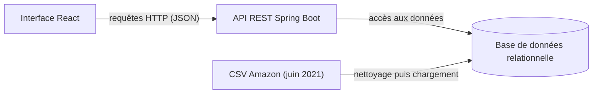

# Plateforme de gestion et d'analyse des ventes (JEE)

Application web complète de gestion et d'analyse des ventes d'un réseau de magasins : gestion des produits et des ventes
(CRUD), tableau de bord analytique, exploration par filtres avancés, alertes, recherche intelligente et analyse prédictive.

Mini-projet du module **JEE** : ENSA Khouribga, filière IID (2ᵉ année), encadré par Pr. Noreddine Gherabi.

## Contexte

La plateforme offre aux acheteurs, vendeurs, analystes marketing et investisseurs une vision claire et basée sur les données
de l'écosystème des best-sellers : quels produits performent, à quels prix et avec quelles caractéristiques.
Les données de départ sont un fichier CSV des ventes de produits Amazon du mois de juin 2021.

## Fonctionnalités

Périmètre défini par le cahier des charges :

**Gestion**
- Produits : ajouter, modifier, supprimer
- Ventes : création, consultation par catégorie, annulation et modification

**Tableau de bord « Best Sellers »**
- Total de produits analysés, nombre de catégories, prix moyen et note moyenne globaux
- Distribution par catégorie et top 10 des produits

**Exploration des produits**
- Filtres par catégorie et par fourchette de prix
- Tri par classement, prix, note ou nombre d'avis
- Export des données (CSV, Excel)

**Analyse par catégorie**
- Prix moyen, produit le mieux noté, produit le plus vendu, distribution des notes

**Alertes personnalisées**
- Nouveau produit dans le top 10, changement de catégorie, catégorie dans le top 10

**Intelligence artificielle**
- Recherche intelligente : par ASIN ou nom de produit, recherche sémantique (« produits électroniques sous 50 $ »,
  « livres avec +1000 reviews », « meilleur rapport qualité-prix »), historique et suggestions automatiques

## Architecture



Préparation des données : identification des valeurs manquantes, analyse des types de données, détection des doublons,
puis chargement dans la base (catégories, produits, ventes).

## Technologies

| Couche | Technologies |
|---|---|
| Frontend | React (Create React App), npm |
| Backend | Java, Spring Boot, Maven, API RESTful |
| Données | Base de données relationnelle, fichier CSV source |

## Structure du dépôt

| Dossier | Contenu |
|---|---|
| [`vente-analytics-frontend/`](vente-analytics-frontend) | Application React (interface utilisateur) |
| [`vente-analytics-backend/`](vente-analytics-backend) | API REST Spring Boot (logique métier et accès aux données) |

## Installation et lancement

**Prérequis** : JDK (version indiquée dans le `pom.xml` du backend), Maven (ou le wrapper `mvnw` s'il est fourni),
Node.js avec npm, et un serveur de base de données relationnelle.

**1. Base de données.** Créez une base vide, puis renseignez la connexion dans
`vente-analytics-backend/src/main/resources/application.properties` :

```properties
spring.datasource.url=jdbc:<sgbd>://localhost:<port>/<nom_de_la_base>
spring.datasource.username=<utilisateur>
spring.datasource.password=${DB_PASSWORD}
```

Le mot de passe est lu dans la variable d'environnement `DB_PASSWORD` : ne l'écrivez jamais en clair dans un fichier versionné.

**2. Backend** (API sur `http://localhost:8080` par défaut) :

```bash
cd vente-analytics-backend
./mvnw spring-boot:run          # ou : mvn spring-boot:run
```

**3. Frontend** (application sur `http://localhost:3000` par défaut) :

```bash
cd vente-analytics-frontend
npm install
npm start
```

## Documentation associée

La conception UML de cette plateforme (cas d'utilisation, modèle du domaine, séquences, classes de conception) est dans le dépôt
[conception-uml-gestion-ventes](https://github.com/Hajar-Bellafrouh/conception-uml-gestion-ventes).

## Auteur
HIBA GOURRI 
Hajar Bellafrouh
